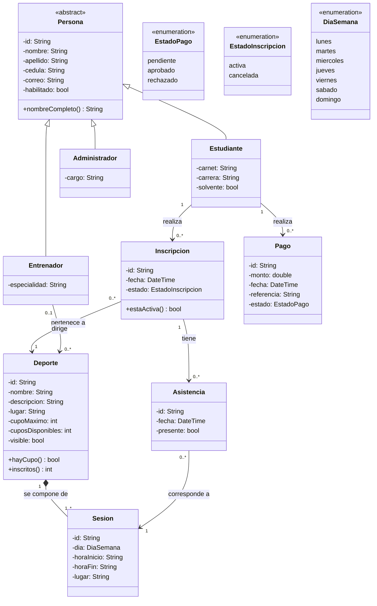

# Diagrama de clases con Pago

Modelo del dominio actualizado a partir del código de `app/lib/modelos/`. Parte de la Figura 3 del Hito 1 y agrega la clase **Pago** con su relación con el Estudiante.

## Decisiones de modelado

- **Pago:** guarda el monto, la fecha, el código de operación (`referencia`) que devuelve la pasarela y el estado. No guarda datos de tarjeta.
- **Estados del pago:** nace `pendiente`. Al aprobarlo el administrador pasa a `aprobado` y el estudiante a `solvente = true` (RF-SIS-07). Un pago `rechazado` no cambia la solvencia.
- **Relación Estudiante - Pago:** un estudiante puede tener varios pagos (por ejemplo, uno rechazado y uno posterior aprobado), y cada pago pertenece a un solo estudiante.
- **Entrenador - Deporte:** un deporte tiene como máximo un entrenador, porque se crea sin entrenador hasta que el administrador lo asigna (CU-09).

## Cambios respecto a la Figura 3 del Hito 1

| Elemento | Hito 1 | Código actual |
|---|---|---|
| Pago y EstadoPago | No existían | Se agregan, con relación a Estudiante |
| Persona | `iniciarSesion()` | Se agrega `habilitado`. El inicio de sesión pasa a `AuthRepository` |
| Deporte | `activo: bool` | `visible: bool`, y el entrenador se referencia con `idEntrenador` (nulo hasta asignarlo) |
| Operaciones de negocio | `inscribirse()`, `cancelar()`, `gestionarDeporte()`, etc. | Pasan a los repositorios (`InscripcionRepository`, `DeporteRepository`, etc.) |
| Fechas | `Date` | `DateTime` |
