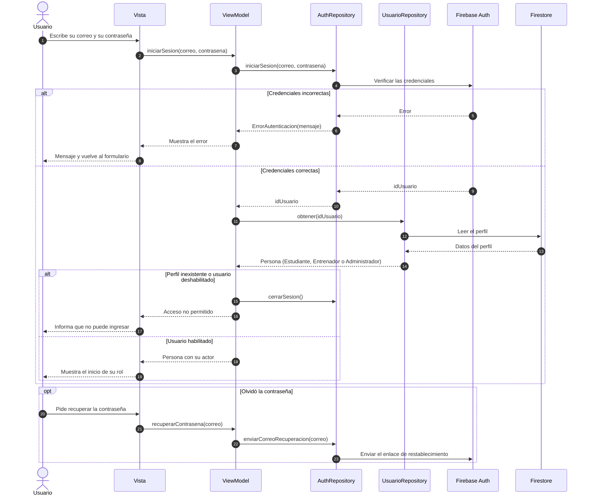

# Diagrama de secuencia: Inicio de sesión

**Caso de uso:** CU-01 Iniciar sesión · **Requisitos:** RF-EST-01, RF-SIS-05, RNF-02

Muestra cómo un usuario (estudiante, entrenador o administrador) inicia sesión y entra a la vista de su rol.

## Notas

- Corresponde a las excepciones de CU-01: 4' credenciales incorrectas y 4'' contraseña olvidada. La excepción 3' (correo no institucional) se valida en el formulario antes del paso 2.
- `Persona.fromMap` crea la subclase correcta según el campo `actor`; con ese dato la Vista decide qué pantalla de inicio mostrar (RF-SIS-05).
- Un usuario con `habilitado = false` no puede iniciar sesión: el ViewModel cierra la sesión recién abierta.
- Los nombres de los métodos del ViewModel son propuestos. Los de los repositorios salen de las interfaces.
