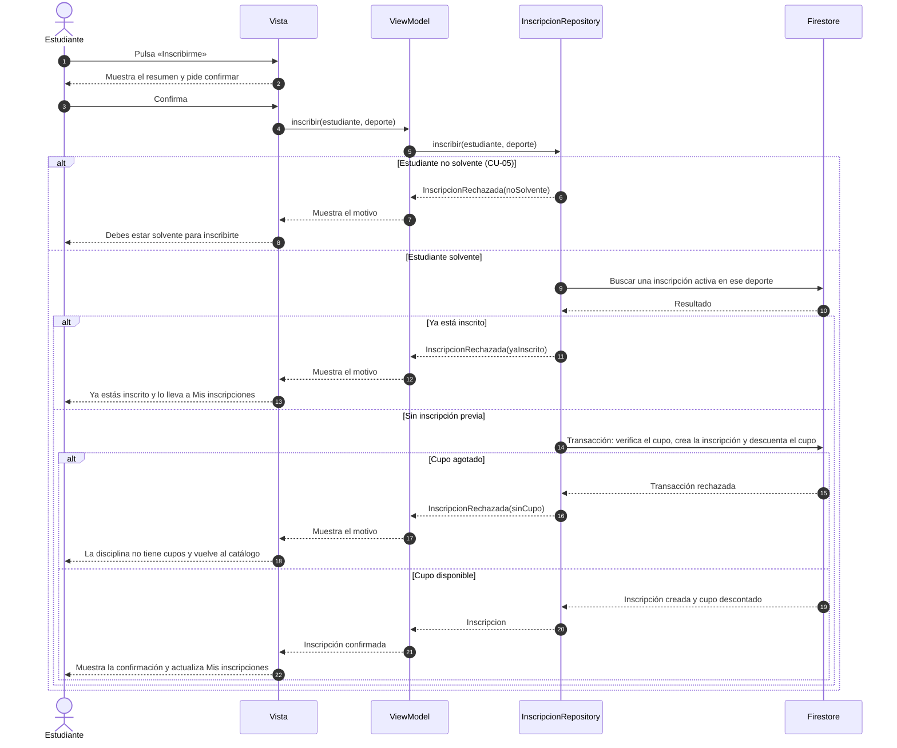

# Diagrama de secuencia: Inscribirse en una disciplina

**Casos de uso:** CU-03 Inscribirse (incluye CU-05 Validar solvencia) · **Requisitos:** RF-EST-04, RF-SIS-01, RF-SIS-02, RF-SIS-03, RF-SIS-04, RNF-05, RNF-07

Muestra el flujo completo con sus flujos alternos. El cupo se verifica y descuenta en una sola transacción, para que dos inscripciones simultáneas nunca superen el cupo (RNF-07).

## Notas

- Las reglas se validan dentro de `inscribir()`, en este orden: solvencia, inscripción duplicada y cupo. Es el mismo orden de CU-03 (pasos 2, 3 y 6) y el que implementa `FakeInscripcionRepository`.
- Según la documentación de `InscripcionRepository`, los tres rechazos se informan con `InscripcionRechazada` y un `MotivoRechazo` (`noSolvente`, `yaInscrito`, `sinCupo`), cada uno con su mensaje para el usuario.
- Diferencia con la Figura 4 del Hito 1: allí la solvencia se consultaba antes de pedir la confirmación. Aquí la confirmación va primero, porque todas las validaciones quedaron dentro de `inscribir()`. El modelo guarda la solvencia en `Estudiante.solvente`, que cambia al aprobar un pago (RF-SIS-07).
- Los nombres de los métodos del ViewModel son propuestos. Los de los repositorios salen de las interfaces.
