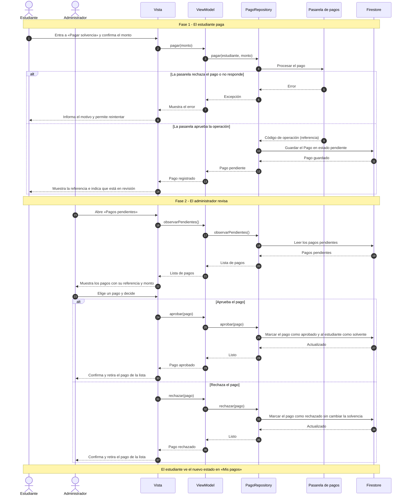

# Diagrama de secuencia: Pago de solvencia

**Casos de uso:** CU-12 Pagar solvencia y CU-16 Revisar pagos · **Requisitos:** RF-EST-08, RF-ADM-05, RF-SIS-07, RF-SIS-11, RF-SIS-12

Muestra las dos fases del pago: el estudiante paga a través de la pasarela y el administrador revisa el pago. El estudiante pasa a estar solvente solo cuando el administrador lo aprueba.

## Notas

- `pagar`, `observarPendientes`, `aprobar` y `rechazar` son los métodos de la interfaz `PagoRepository`. Los nombres de los métodos del ViewModel son propuestos.
- El pago nace en estado `pendiente` y solo cambia a `aprobado` o `rechazado` por decisión del administrador. Un pago ya revisado no se puede revisar de nuevo.
- Si la pasarela rechaza la operación, no se guarda ningún pago.
- Este flujo se puede probar sin Firebase ni pasarela con `FakePagoRepository` (opciones `pasarelaRechaza` y `debeFallar`) junto con `FakeUsuarioRepository`.
