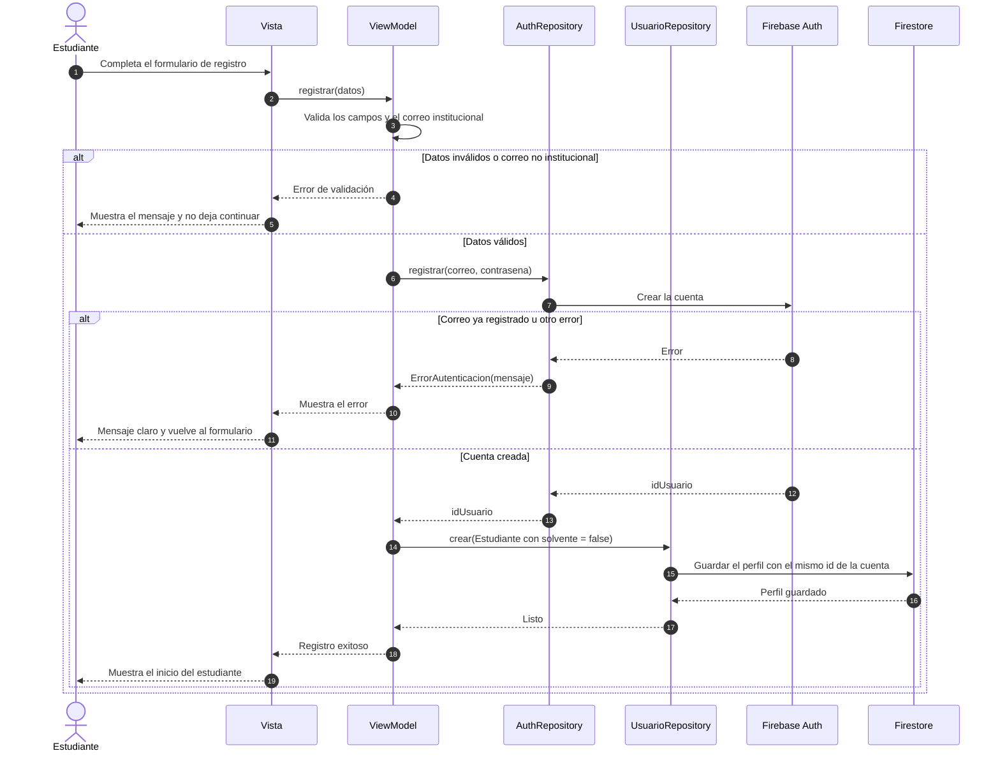

# Diagrama de secuencia: Registro de usuario

**Requisitos:** RF-EST-01, RNF-02, RNF-06 · **Relación con casos de uso:** el registro del estudiante es la precondición de CU-01 Iniciar sesión.

Muestra cómo un estudiante crea su cuenta y su perfil. Los entrenadores y administradores no se registran solos: los crea el administrador (CU-09).

## Notas

- Los métodos `registrar` y `crear` salen de las interfaces `AuthRepository` y `UsuarioRepository`. Los nombres de los métodos del ViewModel son propuestos, porque esa capa todavía no está implementada.
- Un estudiante nuevo nace con `solvente = false`: debe pagar (CU-12) antes de poder inscribirse (CU-03).
- Punto por definir en el ViewModel: si la cuenta se crea pero falla el guardado del perfil, queda una cuenta sin perfil.
- Este flujo se puede probar sin Firebase con `FakeAuthRepository` y `FakeUsuarioRepository` (`app/test/fakes/`).
